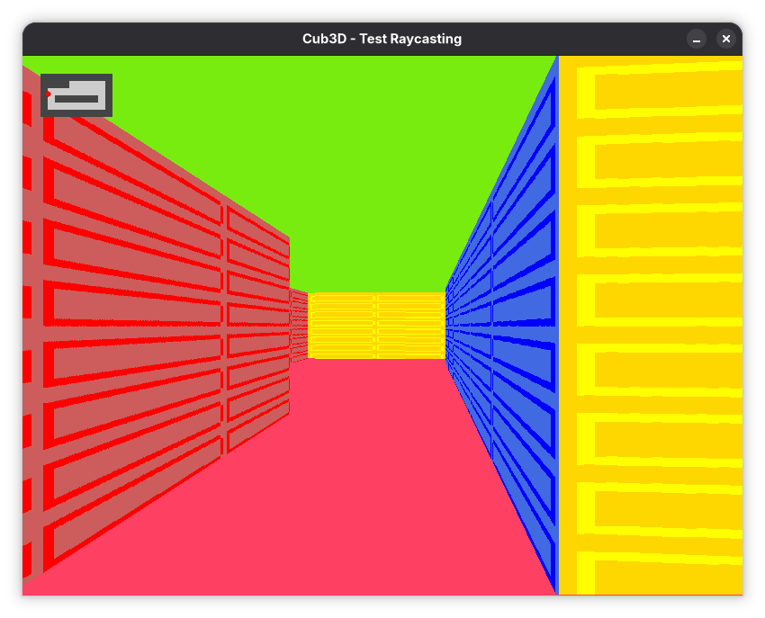
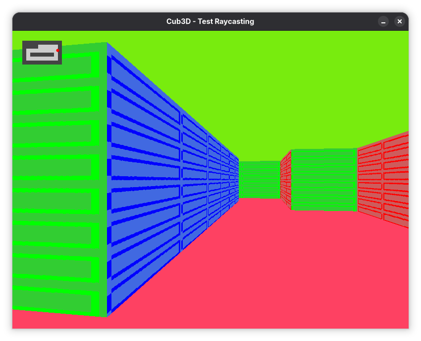

# cub3D

A first-person 3D maze rendered in real time with **raycasting**, written in C and inspired by *Wolfenstein 3D* (1992).

<p align="center">
  
  
</p>


A 42 Paris project about graphics programming, vector math and event-driven loops, built on the MiniLibX.

<!-- TODO: if you did this project as a pair, add: Built in a team of two with [@login](https://github.com/login). -->

## Features

- Real-time 3D rendering of a 2D grid map using raycasting
- A different texture for each wall orientation (north, south, east, west)
- Configurable floor and ceiling colours
- Smooth movement and rotation while keys are held down
- Minimap showing the walls and the player's position
- Strict parsing of the `.cub` scene file, with an explicit error message for any invalid input

## Getting started

### Requirements

- Linux with X11 and `gcc`
- X11 development headers:
  - Debian / Ubuntu: `sudo apt install libx11-dev libxext-dev`
  - Fedora: `sudo dnf install libX11-devel libXext-devel`
- The [MiniLibX](https://github.com/42Paris/minilibx-linux), placed in `minilibx/minilibx-linux`

### Build

```bash
git clone https://github.com/42Paris/minilibx-linux.git minilibx/minilibx-linux
make -C minilibx/minilibx-linux
make
```

> **Note — GCC 15 and newer** compile in C23 by default, which no longer accepts the MiniLibX hook prototypes (`int (*funct)()`).
> Build with the C17 standard instead:
> ```bash
> make -C minilibx/minilibx-linux CC="gcc -std=gnu17"
> make CC="gcc -std=gnu17"
> ```

| Command | Effect |
| --- | --- |
| `make` | Builds `cub3d` |
| `make clean` | Removes object files |
| `make fclean` | Removes object files and the binary |
| `make re` | Rebuilds from scratch |

### Run

<!-- TODO: replace with the path of a real map from the repo -->
```bash
./cub3d maps/map.cub
```

### Controls

| Key | Action |
| --- | --- |
| `W` `A` `S` `D` | Move forward, left, backward, right |
| `←` `→` | Turn the camera |
| `ESC` or window ✕ | Quit |

## Scene file (`.cub`)

The program takes a single `.cub` file that describes the textures, the colours and the map.

```
NO ./textures/north.xpm
SO ./textures/south.xpm
WE ./textures/west.xpm
EA ./textures/east.xpm

F 255,65,100
C 120,235,20

1111111111
1000000001
1011110001
1000000N01
1111111111
```

| Element | Meaning |
| --- | --- |
| `NO` `SO` `WE` `EA` | Path to the XPM texture for each wall orientation |
| `F` / `C` | Floor / ceiling colour in RGB (0–255) |
| `1` / `0` | Wall / empty space |
| `N` `S` `E` `W` | Player spawn point and starting direction |

The map must be fully enclosed by walls. Otherwise, the program prints `Error` followed by the reason and exits.

## How it works

1. **Parsing** — The `.cub` file is read line by line with `get_next_line`. Textures and colours are loaded, then the map is checked: valid characters, exactly one player, and closed by walls.
2. **Raycasting** — For each column of the window, a ray is cast from the player's position. It moves through the grid one cell at a time (DDA algorithm) until it hits a wall.
3. **Wall height** — The distance to the wall is measured perpendicular to the camera plane, which removes the fish-eye effect. The closer the wall, the taller the column drawn on screen.
4. **Texturing** — The face that was hit (N, S, E or W) selects the texture. The exact impact point gives the texture column to draw, stretched to the height of the wall.
5. **Game loop** — Key press and key release events update the player's movement state. A loop hook moves the player and redraws the frame, so movement stays smooth.

## What I learned

- Applying vectors and trigonometry to a concrete problem: direction vector, camera plane, rotation
- Implementing the DDA algorithm to find wall intersections efficiently
- Texture mapping and rendering a full frame in real time
- Event-driven programming with the MiniLibX: hooks and render loop
- Writing a robust parser with clear error handling

## Project structure

```
.
├── assets/                    # Screenshots used in this README
├── includes/                  # Headers and data structures
├── src/
│   ├── main/                  # Entry point, window and event hooks
│   ├── parsing/               # .cub parsing and map validation
│   ├── textures/              # XPM texture loading
│   ├── rendering/             # Raycasting, wall drawing, minimap
│   ├── movement/              # Keyboard input, movement, rotation
│   └── GNL/                   # get_next_line
└── minilibx/minilibx-linux/   # MiniLibX graphics library (to clone)
```
